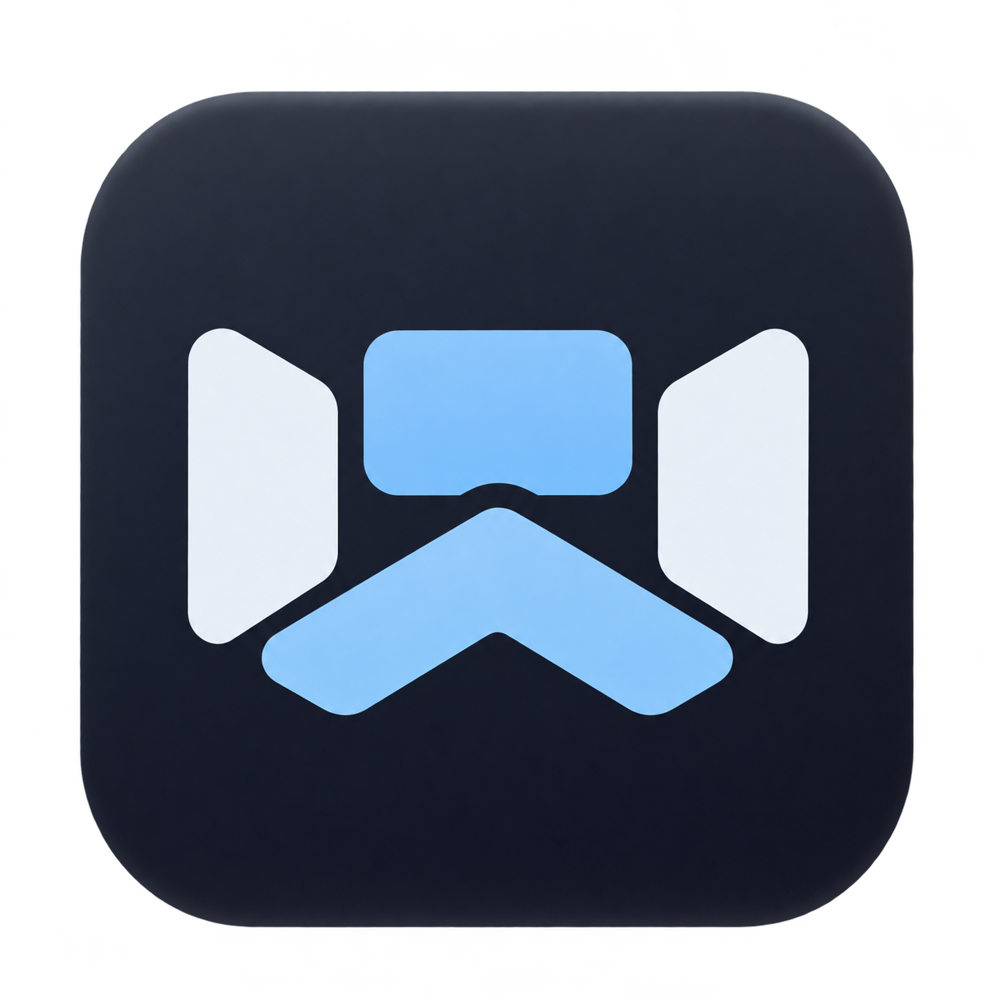

# IWE Code



A native workspace for projects, source code, Git history, and pipelines. Built with Rust and Iced.

Visit the [IWE Code website](https://adametsderschopfer.github.io/iwe-code/) for an overview and
downloads. The Nuxt website lives in `website/`. See
[website development and deployment](docs/website.md).

Create named spaces and add local project folders. Browse files with syntax highlighting and inspect
branches, commits, and historical file versions. Connect GitHub Actions or GitLab pipelines through
browser sign-in. Self-hosted GitLab supports personal access tokens. Open settings with the gear at
the bottom left. Preferences persist between launches. English, Russian, and Spanish translations
are embedded in the executable.

View bundled modules under **Settings → Modules**. The first system module provides an integrated
terminal for the selected project. System modules are always enabled and cannot be removed. See
[modules and terminal sessions](docs/modules.md) for controls and limits.

The Deployment module browses SFTP, FTP, and FTPS servers. Configure shared connections and
deployment profiles within each space. Compare remote files, upload local files, and download files
through folder mappings. See [deployment](docs/deployment.md) for setup and shortcuts.

IWE Code caches project trees locally and refreshes folder listings in the background. It reads
source contents when files open. File previews leave repository files unchanged, and source contents
stay local until an explicit deployment upload. Terminal commands can change files and use the
network with your account's permissions. See [workspace behavior](docs/workspace.md) for limits,
authentication, and keyboard shortcuts.

One version tag publishes a GitHub Release for macOS, Windows, and Linux. Packages cover macOS Apple
Silicon and Intel, Windows x86 and x64, and Linux x86 and x64. Windows packages include a per-user
installer and a portable ZIP. See [release packages and publishing](docs/ci.md#release-packages) for
installation requirements and the tag workflow.

IWE Code can download signed updates from GitHub Releases and install them after confirmation. See
[application updates](docs/updates.md) for installation requirements and release signing.

## Requirements

- Rust 1.90.0, installed through rustup.
- dprint 0.64.3 for documentation and configuration formatting.
- cargo-audit 0.22.2 for dependency security checks.
- Make for the convenience commands below.
- Git for repository history.
- A browser for GitHub and GitLab.com sign-in.
- An unlocked system credential store for saved accounts.

On macOS, install Xcode Command Line Tools. On Windows, install Visual Studio Build Tools with the
C++ workload. On Linux, install `pkg-config`, `libx11-dev`, `libxkbcommon-dev`, `libwayland-dev`,
and `libudev-dev`.

On Windows, IWE Code first looks for `git.exe` in `PATH`. It also searches standard Git for Windows
installations under Program Files and the current user's `LocalAppData/Programs` directory. Custom
or portable installations require their Git directory in `PATH`. A project's `.git` directory
contains repository data, not the Git executable.

Linux accounts require a running Secret Service, such as GNOME Keyring or KWallet with Secret
Service support. IWE Code does not require GitHub CLI or GitLab CLI. Browser sign-in requires
registered provider applications. See [authentication setup](docs/authentication.md) for public
Client IDs and registration instructions.

Install the dependency checker:

```sh
cargo install cargo-audit --version 0.22.2 --locked
```

## Run

```sh
make run
```

You can also open a directory directly:

```sh
cargo run --locked -- /path/to/project
```

Existing project folders open in their saved space. New folders appear in the space creation form.

The application uses the system language. Set `IWE_LANG` to override it:

```sh
IWE_LANG=en make run
IWE_LANG=ru make run
IWE_LANG=es make run
```

In PowerShell, set `$env:IWE_LANG = "en"` before running `cargo run --locked`. Unsupported languages
fall back to English.

## Build and verify

```sh
make fmt
make check
make build
make release
```

`make check` runs formatting, Clippy, type checks, tests, and dependency security checks. `make
build` creates `target/debug/iwe`. `make release` creates `target/release/iwe`. Windows executable
names include `.exe`.

Without Make, use the Cargo and dprint commands defined in [Makefile](Makefile). See
[the architecture](docs/architecture.md) and [the CI guide](docs/ci.md) for implementation details.

Read [the development rules](AGENTS.md) before changing the project. That guide lists mandatory
rules and additional reading for each task.

## License

IWE is licensed under the [Apache License, Version 2.0](LICENSE). Third-party components retain
their respective licenses.
